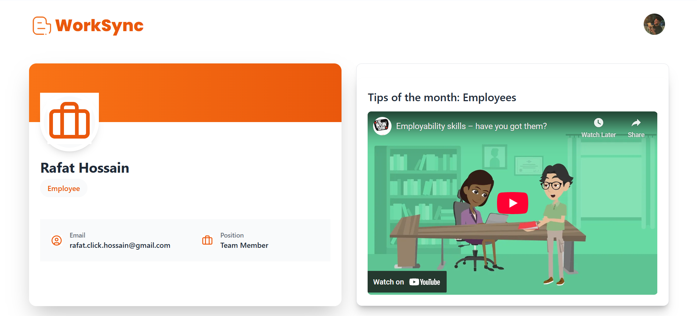
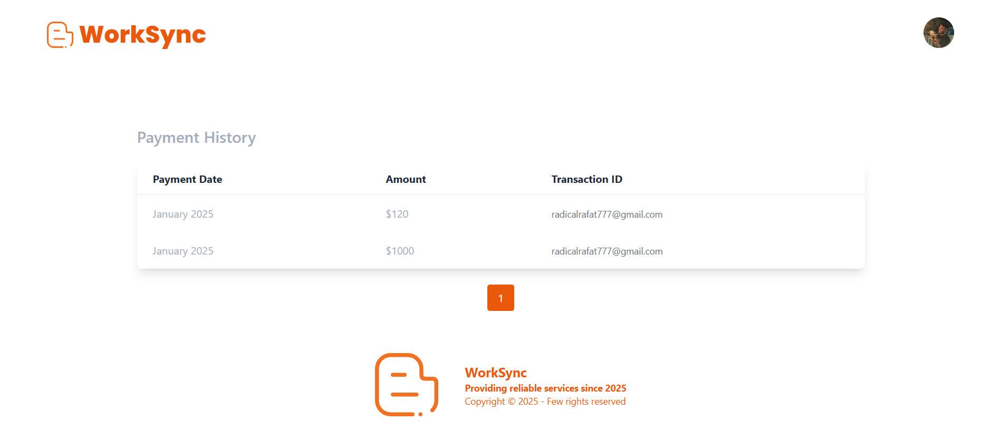
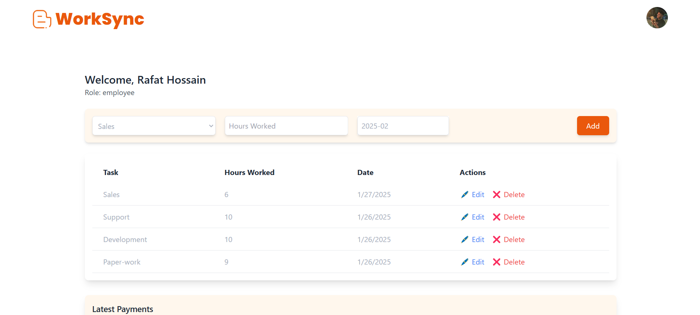
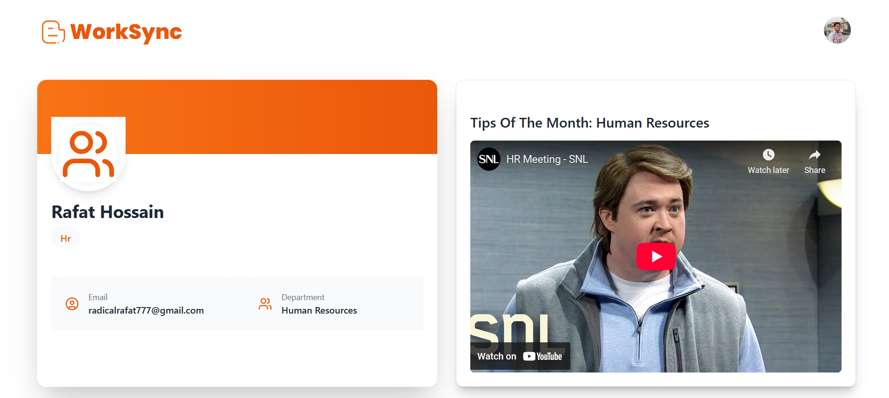
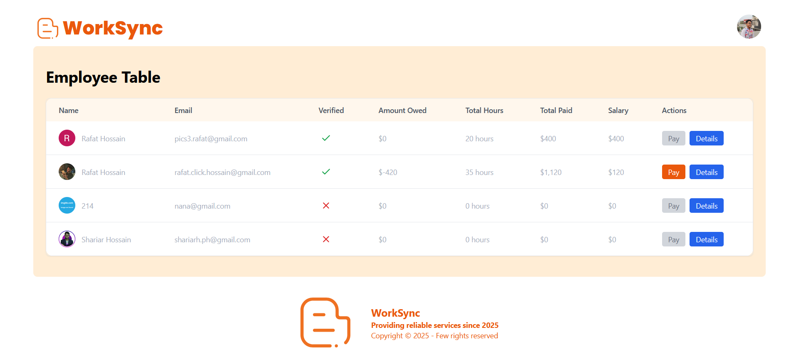
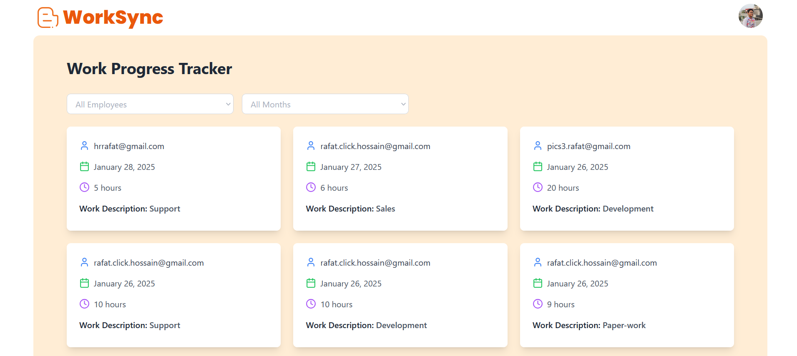
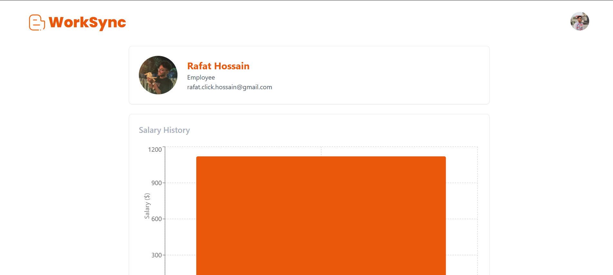
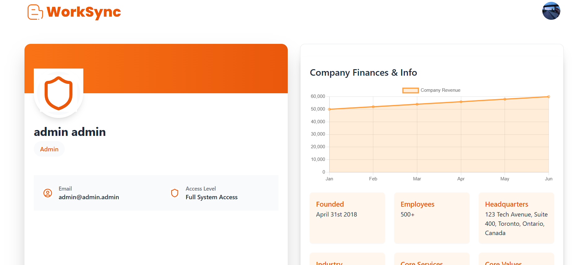
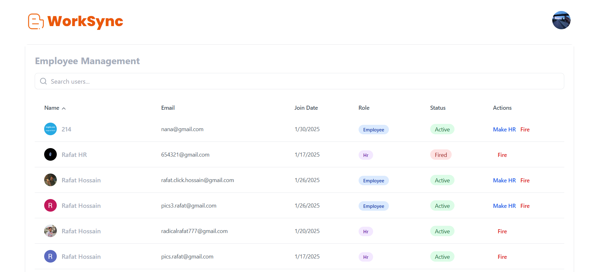
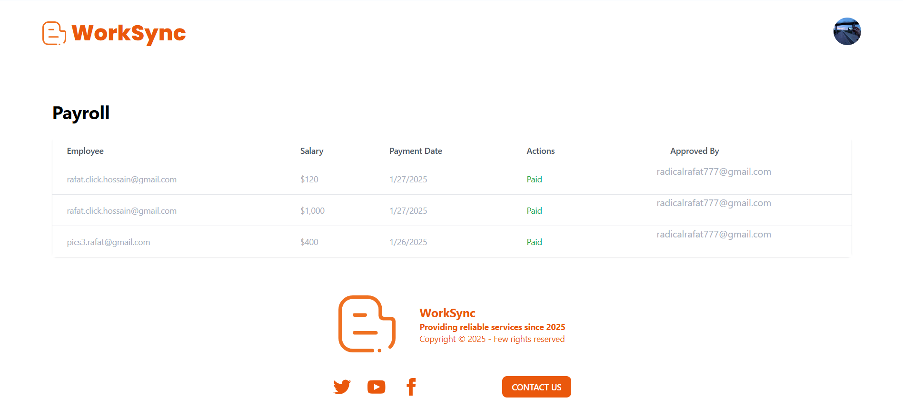

# WorkSync Client

React front end for WorkSync, a role-based employee management app. This repository is the client only. The Express/MongoDB API lives in [WorkSync-Server](https://github.com/RafatH0ssain/WorkSync-Server).

## Demo

https://worksync-2ca3b.web.app

Only Employee accounts can sign up on the public demo. Email me if you need HR or Admin access.

## Quickstart

Prerequisites: Node.js 18 or newer, npm, and a Firebase project with Email/Password and Google auth enabled.

```bash
git clone https://github.com/RafatH0ssain/WorkSync-Client.git
cd WorkSync-Client/WorkSync
cp .env.example .env
# fill in the six VITE_FIREBASE_* values from your Firebase project settings
npm install
npm run dev
```

Vite serves the app at http://localhost:5173.

Other scripts: `npm run build`, `npm run lint`, `npm run preview`.

The client calls the deployed WorkSync-Server API by default. Firebase handles sign-in; the server stores users, work logs, and payroll records.

## What each role can do

**Employee.** Log hours and tasks by date, submit payment requests, and review past payments and request status. New accounts start as Employee.

**HR.** Verify employees, review work logs and hours, process payment requests, and browse the employee list, details, and salary history.

**Admin.** Promote employees to HR, adjust salaries, ban users, and approve or decline payment requests before payout. Admin sees every employee and payroll record.

## Screenshots

### Employee

- Dashboard
  

- Past payments
  

- Add payment request
  

### HR

- Dashboard
  

- Employee table
  

- Payroll table
  

- Employee details
  

### Admin

- Dashboard
  

- All employees
  

- Payroll
  

## Tech

- React 18 and Vite
- Firebase Authentication (email/password and Google)
- React Router
- TanStack Table and React Query
- Tailwind CSS and DaisyUI
- Chart.js and Recharts
- Axios and fetch for API calls

## License

MIT. See [LICENSE](./LICENSE).

## Contact

Email: [rafat.click.hossain@gmail.com](mailto:rafat.click.hossain@gmail.com)

LinkedIn: [Muhammad Rafat Hossain](https://www.linkedin.com/in/muhammad-rafat-hossain/)
